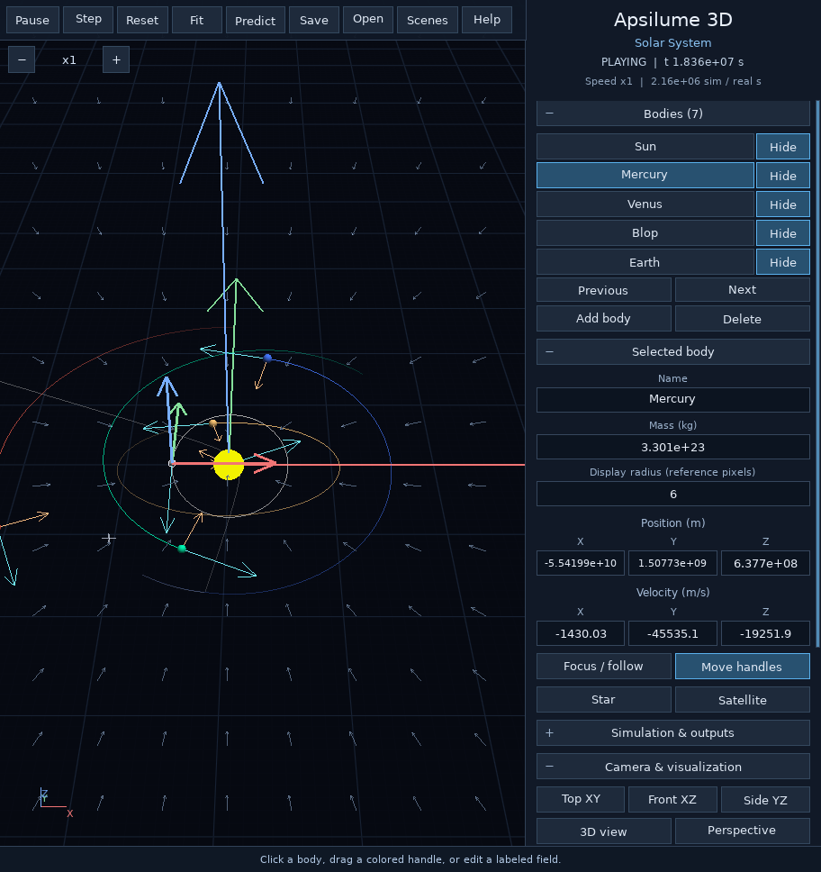

# Apsilume

Apsilume is an interactive 3D N-body orbital simulator built in C++, featuring Newtonian gravity, coupled RK4 integration, real-time body editing, trajectory prediction, and field visualization.

The name combines **apsis** and **luminous**. This is the Project-S3 experimental continuation of OrbitSimLite.



## For developers

Start with the [developer guide and file map](docs/architecture.md). It gives a reading order, explains ownership and frame/solver flow, and maps common feature changes to the relevant implementation files. Public headers document contracts; implementation comments explain the important mathematical and state-management choices.

## Features

- Newtonian gravity in XYZ, with symplectic Euler and fully coupled RK4 integration.
- Orbit, pan and zoom controls, plus top, front and side camera views.
- Labeled position/velocity fields and draggable axis handles for editing bodies.
- Body selection, visibility, collision policies and saved scenes.
- Fixed numerical timesteps independent of playback speed and rendering.
- Incremental trajectory forecasts, field visualization and live JSON/CSV exports.
- A graphics-free mode for deterministic numerical experiments.

## Build and run

Requirements: a C++17 compiler, CMake 3.16+, SFML and OpenGL development libraries. The build prefers SFML 3 and retains compatibility branches for SFML 2.5+. JSON headers, the font and their licenses are included.

From the repository root:

```sh
./run-3d.sh
```

Or build manually:

```sh
cmake -S . -B build -DCMAKE_BUILD_TYPE=Release
cmake --build build -j 4
./build/orbit_simulator
```

Choose a scene in the graphical launcher and click **Start scene**. Right-drag to orbit, middle-drag to pan, and scroll to zoom. Select a body to edit its XYZ properties. Space pauses playback, H toggles the grid, G toggles origin axes and P toggles prediction.

The current executable, CMake options, C++ namespace and saved-data directory retain their OrbitSimLite names for compatibility. The full control list and persistence format are in the [user guide](docs/user-guide.md).

## Tests and headless mode

[GitHub Actions](.github/workflows/core.yml) builds and runs the existing tests on Linux, Windows and macOS after pushes and pull requests. A manual **Run workflow** option is also available in the repository’s **Actions** tab once the workflow is pushed to the default branch.

The test sources stay in `tests/`; no copying or moving is required. Each run also checks a 100-step headless simulation and JSON/CSV output. Test reports and logs are downloadable from the workflow run for seven days. These jobs exercise the graphics-free core; the interactive desktop workflow remains a separate local check.

```sh
ctest --test-dir build --output-on-failure
```

A build without SFML/OpenGL dependencies:

```sh
cmake -S . -B build-headless -DORBITSIMLITE_BUILD_GUI=OFF -DCMAKE_BUILD_TYPE=Release
cmake --build build-headless -j 4
ctest --test-dir build-headless --output-on-failure
./build-headless/orbit_simulator --headless --scene 2 --steps 100 --data-dir /tmp/apsilume-test
```

See [the recorded validation](docs/validation.md) and [the human usability protocol](docs/usability-test.md) for scope and remaining platform checks.

## Repository layout

| Path | Contents |
|---|---|
| `CMakeLists.txt` | Build, test and installation targets |
| `src/`, `include/` | Physics, scene model, controllers and 3D editor |
| `examples/` | Application entry points and numerical benchmark |
| `tests/` | Physics, N-body, spatial, product and desktop workflow checks |
| `assets/` | Bundled font and license |
| `third_party/` | Vendored JSON dependency and license |
| `docs/` | User guide, validation, usability protocol and preview |
| `.github/workflows/` | Headless build and test workflow |

Local build directories, compiled packages and generated simulation data are excluded by `.gitignore`. Source, documentation, preview images and required assets are included.

## Rights

Copyright (c) 2026 Valery. All rights reserved. Apsilume's original work is proprietary; use by anyone other than the copyright holder requires prior written permission. See [LICENSE](LICENSE). Third-party components and fonts retain their own licenses.
