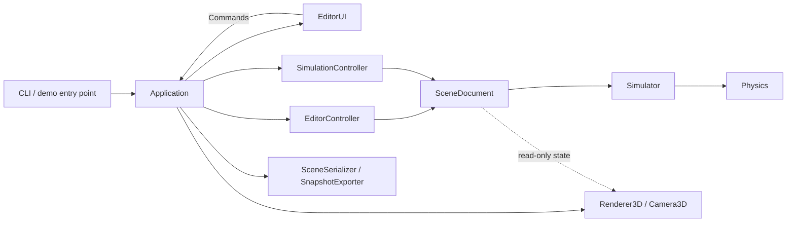

# Apsilume developer guide

This guide is the starting point for understanding the code after time away. It describes ownership, call order and the assumptions that connect the files. The [user guide](user-guide.md) documents controls and commands; this document explains their implementation.

The public C++ namespace, target names and persistent-data directory retain `orbitsimlite`/`OrbitSimLite` for compatibility. The product name is Apsilume.

## Read the code in this order

1. [Body](../include/body.hpp), [Vec3](../include/vec3.hpp) and [ScenarioPreset](../include/scene.hpp): understand the values and units first.
2. [Simulator](../src/simulator.cpp), then [Physics](../src/physics.cpp): follow one numerical timestep.
3. [SceneDocument](../include/scene_document.hpp) and [SimulationController](../src/simulation_controller.cpp): distinguish editable state from playback scheduling.
4. [Application::run](../src/application.cpp): follow one graphical frame from input to drawing.
5. [Application::dispatch](../src/application_actions.cpp) and [EditorController](../src/editor_controller.cpp): trace a user change into the model.
6. Open the UI, renderer or persistence file for the feature you want to change, using the maps below.

Headers explain contracts and state ownership. Implementation comments explain consequential choices, such as synchronized RK4 stages, cache invalidation and atomic replacement. Straightforward arithmetic/accessors are left readable without narrating every line.

## Ownership and dependencies



`orbitsimlite_core` contains numerical, document, editing, serialization and headless services. It has no SFML/OpenGL dependency. `orbitsimlite` adds the graphical application. `orbitsimlite_launcher` selects the launch mode. These boundaries are declared in [CMakeLists.txt](../CMakeLists.txt).

Use `<orbitsimlite/core.hpp>` for a graphics-free C++ client. The older `<orbitsimlite/orbitsimlite.hpp>` umbrella includes the GUI compatibility facade and therefore requires graphical dependencies.

### Core and persistent state

| Files | Purpose and boundary |
|---|---|
| `include/vec3.hpp`; `include/vec2.hpp`, `src/vec2.cpp` | Vector arithmetic. Vec3 is the simulation type; Vec2 supports older planar callers. |
| `include/body.hpp`, `src/body.cpp` | One body's physical state, stable ID and display attributes. Construction does not allocate IDs. |
| `include/physics.hpp`, `src/physics.cpp` | Acceleration and integration algorithms; no window, clock, file or editor state. |
| `include/simulator.hpp`, `src/simulator.cpp` | Own bodies, assign IDs, choose integrator/substeps and advance simulation time. |
| `include/scene.hpp`, `src/scene.cpp` | Preset/output value types, plane geometry and option labels shared across layers. |
| `include/scene_catalog.hpp`, `src/scene_catalog.cpp` | Built-in initial conditions. Demo entry points reuse this catalog. |
| `include/scene_document.hpp`, `src/scene_document.cpp` | Live simulation, scene metadata, Reset baseline, dirty/revision state and selected body ID. |
| `include/editor_controller.hpp`, `src/editor_controller.cpp` | Property validation and scene mutations used by fields, keys and dragging. |
| `include/simulation_controller.hpp`, `src/simulation_controller.cpp` | Fixed-step scheduling, playback speed and simplified collision decisions. |
| `include/trajectory_prediction.hpp`, `src/trajectory_prediction.cpp` | Incremental forecast on an isolated simulation copy. |
| `include/app_paths.hpp`, `src/app_paths.cpp` | Locate user-data folders and the executable; create directories with errors reported to the caller. |
| `include/scene_serializer.hpp`, `src/scene_serializer.cpp` | Validated scene JSON and atomic file replacement. |
| `include/snapshot_exporter.hpp`, `src/snapshot_exporter.cpp` | Throttled latest-state JSON/CSV, separate from reusable scene files. |
| `include/headless_runner.hpp`, `src/headless_runner.cpp` | Run exact-step or wall-clock experiments without graphics objects. |

### Graphical application

All application files implement the same [Application class](../include/application.hpp). Splitting implementation files does not create extra owners of the document.

| File | Work to look for |
|---|---|
| `src/app_launcher.cpp` | Parse CLI options; construct either the graphical application or the headless core services. |
| `src/application.cpp` | Window lifetime and the main frame loop. |
| `src/application_events.cpp` | SFML 2/3 event-shape differences translated into common handlers. |
| `src/application_input.cpp` | Camera gestures, picking, axis dragging, keyboard precedence and paired text events. |
| `src/actions.cpp` | Shortcut/tooltip metadata. It describes commands; it does not perform edits. |
| `src/application_actions.cpp` | Shared command execution and the unsaved-change guard. |
| `src/application_scene.cpp` | Apply/reset scene presentation state, enumerate saved files and coordinate named saves. |
| `src/application_diagnostics.cpp` | Optional test-state JSON, enabled only by `ORBITSIMLITE_UI_STATE`. |
| `include/renderer.hpp` | Compatibility adapter for existing Renderer callers. New editor behavior belongs in the services above. |

### UI composition

All six UI implementations share [EditorUI](../include/editor_ui.hpp). They draw controls and turn interactions into commands/controller calls; they do not integrate gravity.

| File | Responsibility |
|---|---|
| `src/editor_ui.cpp` | Compose the frame: sidebar, wrapping toolbar, status bar, orientation indicator and modal overlay. |
| `src/editor_ui_text.cpp` | Load the bundled font; measure, fit, wrap and draw text. |
| `src/editor_ui_widgets.cpp` | Reusable buttons and fields; visible input substring, selection highlight and caret. |
| `src/editor_ui_input.cpp` | Focus, UTF-8 text editing, field commit/cancel, hit routing, sidebar scrolling and UI-local pagination. |
| `src/editor_ui_panel.cpp` | Body list, inspector, simulation/output controls and camera sections. |
| `src/editor_ui_dialogs.cpp` | Scene chooser, save/load/confirmation/help layouts and responsive footer rows. |
| `src/editor_ui_detail.hpp` | Private shared rectangle/formatting primitives, panel boundaries and UI-only navigation constants; not a public API. |

### Spatial rendering

| Files | Responsibility |
|---|---|
| `include/camera3d.hpp` | Camera basis, projection/unprojection, ray intersections and navigation; independent of SFML. |
| `src/renderer3d.cpp` | Fit/resize the camera, retain ID-keyed trails and construct axis-handle geometry. |
| `src/renderer_draw.cpp` | OpenGL scene pass: spheres, trails, axes, vectors, forecasts and move handles. |
| `src/renderer_field.cpp` | Infinite reference/deformed plane, its GLSL shader and bounded illustrative source list. |

## Model contracts you should preserve

### Units, identity and ownership

- Astronomical presets use SI; Figure Eight uses dimensionless values with G=1. `ScenarioPreset::units` controls labels/defaults, not automatic conversion. Use one consistent unit system per scene.
- `Body::radius` is a reference display size. Renderer/collision proxy radius in world length is `radius / scene scale`. Camera zoom changes viewing distance rather than these world radii.
- Star/satellite flags do not remove bodies from gravity. Star changes visual treatment; satellite bodies are excluded from collision handling.
- `Simulator` assigns missing/duplicate IDs when bodies enter its container. IDs are used for selection, trails and saved files. Indices/pointers are temporary; adding, deleting, merging or replacing bodies can invalidate them.
- `SceneDocument::initial` is the state last applied by a preset/open operation. Reset uses that baseline. Saving copies the current state; it does not redefine the baseline.
- `dirty` and `revision` describe explicit edits/collisions. Ordinary simulation advancement changes positions/time without marking the document dirty or incrementing the edit revision.

### One numerical step

`Simulator::step()` advances one outer `dt`, including in an empty scene. For occupied scenes it takes `substeps` synchronized internal steps of size `dt / substeps`.

Euler gathers all accelerations from the same positions before moving any body, then updates velocity before position (symplectic Euler). Its stored acceleration is the one used for that substep.

System RK4 integrates `(position, velocity)` with derivatives `(velocity, acceleration)`. Every stage evaluates all sources at that stage's positions. Pair evaluations add mass-weighted accelerations to both bodies, preserving action/reaction force symmetry. After combining stages with weights 1,2,2,1 over 6, it recomputes stored accelerations at the final joint state.

`Physics::step_rk4()` is a separate single-body helper for a prescribed external field. Its source list must exclude the target: those sources stay fixed during stage evaluation. Moving mutually interacting systems use `step_rk4_system()`.

Pairs below `MinimumSeparationSquared` are skipped to avoid singular division. This is a cutoff rather than a smooth softening model. Visual/collision radii are handled elsewhere.

### Real time, solver time and rendering time

`SimulationController` converts wall time into requested simulation time:

```text
queued simulation time += real elapsed seconds × base_rate × speed
while enough time remains and the work budget allows:
    integrate exactly dt
    process collision policy
    notify the caller that a step completed
    subtract dt from the queue
```

`configure()` initially sets `base_rate = scene.dt × 60`. Playback speed changes the requested rate; changing numerical dt changes accuracy/work per step while leaving that configured rate intact. The per-frame step/time budget retains backlog rather than silently dropping it. Pause clears queued time; single-step requests exactly one outer dt.

The GUI skips advancement while fields/dialogs or axis dragging are active. The rest of the window remains responsive. Collision prompts also suspend advancement until handled. Collision erasure resolves one pair per call because it invalidates body-vector references and indices.

## Follow a user edit end to end

For a Z-position field:

1. `EditorUI::field()` draws and registers a control using the same rectangle.
2. `EditorUI::click()` focuses it, remembering the selected body ID and a UTF-8 edit buffer.
3. Enter reaches `EditorUI::commit()`, which checks selection identity and calls `EditorController::set_property()`.
4. The controller validates the number, applies the value and calls `SceneDocument::mark_edited()`; invalid input stays focused with its error.
5. The next application frame notices a new revision, clears trails/prediction, and resets queued time while preserving the current paused state.
6. Rendering and export see the new model state.

Shortcuts and move handles share controller mutations. Button and shortcut actions converge at `Application::dispatch()`. A field consumes typing/navigation keys before global shortcuts run. The K shortcut suppresses its paired text event so opening Save does not insert a leading `k`.

Before exit/reset/scene replacement, dispatch stores a pending command if the document is dirty. Save/Discard can resume it once; Cancel forgets it. File writing itself remains in `SceneSerializer`.

## Coordinates, GPU precision and text layout

World positions/velocities remain double precision. `Camera3D::view()` reports positive depth in front of the camera; OpenGL uses the opposite Z sign. Rendering subtracts camera position and normalizes by camera distance before passing values to the GPU. Picking and editing retain world-space doubles.

Projection uses the scene canvas width, excluding the sidebar, and the full window height. Screen Y points down; OpenGL scissor Y starts at the bottom. Projection, ray construction, handle hit geometry and drawing must agree on this viewport and camera basis.

If you change field of view or normalized near/far planes, update `Camera3D`, the world projection and the grid shader together. The shader mirrors the camera's tangent constant. Grid curvature is an illustrative inverse mapping, with at most 64 large-mass sources; the physics solver still includes every body. Velocity/acceleration arrow lengths are display-scaled direction indicators.

UI drawing uses the font glyph atlas directly to avoid a reproduced `sf::Text` teardown issue. Measurement and drawing must use identical glyph bounds and kerning. Text rectangles are aligned using visible bounds rather than character counts. UTF-8 edit carets are byte offsets; `sf::String` display slicing uses character indices, so conversion is explicit. Ellipsis/scrolling only changes the visible text, never the stored value.

Widgets are rebuilt each frame. The same panel boundaries govern clipping, hit testing and test-reported rectangles. The toolbar's actual wrapped height determines where scene interaction can begin. Modal body layout reserves status/footer space first to prevent overlap.

## Predictions, saves and exports

Prediction is a cache over a private `Simulator` copy. It estimates a horizon from a dominant-source orbital period or view-sized free-flight distance, capped in base-step units. It uses the selected solver/substeps, but may enlarge preview dt to stay within 4,096 steps. Samples, work budget and refresh cadence have separately named limits. Editing while paused restarts immediately; playback refreshes after a completed preview ages. These previews are approximate, especially for chaotic encounters.

Reusable scenes use schema version 2 and nested XYZ vectors. The loader accepts legacy flat XY coordinates and defaults missing Z to zero. It builds a candidate, validates the complete scene, assigns missing IDs, then replaces the output. Failed reads never partially change the current document.

Saving writes a temporary file beside the destination, closes it, then replaces the destination. Readers see a whole old or new file; this does not promise persistence through power loss. Scene names are sanitized into filenames, while `AppPaths` selects their directory.

Live JSON/CSV files are latest-state snapshots, updated at most 10 times per real second plus forced initial/final writes. They are not trajectory recordings or reusable scene definitions. Legacy output keys such as `time_seconds` carry the scene's simulation-time units, including dimensionless scenes.

## Change a feature in the right place

| Intended change | Start here | Verify with |
|---|---|---|
| Gravity/integration algorithm | `physics.cpp`, `simulator.cpp` | physics, N-body and spatial suites; convergence/conservation matter |
| New/editable body property | Body/preset, serializer, EditorController, inspector and export formats | product persistence/validation tests and desktop edit/save/reopen |
| Shortcut or toolbar action | ActionRegistry, `application_actions.cpp`, relevant UI layout | desktop workflow and matching button/key behavior |
| Camera/projection/picking | `camera3d.hpp`, renderer draw/field projection, input handler | spatial projection/ray tests and visual resize checks |
| Text/spacing/field rendering | UI text/widgets/panel/dialog files | desktop workflow, small/large windows and long Unicode names |
| Scene format or user paths | serializer, AppPaths, scene coordination | legacy/Unicode roundtrips and failed-write tests |
| Output cadence/columns | SnapshotExporter and headless runner | product output checks and CLI smoke test |
| New built-in experiment | SceneCatalog | preset roundtrip, numerical sanity and graphical framing |

The [CTest suites](../tests/) cover numerical, spatial and document contracts. [GitHub Actions](../.github/workflows/core.yml) runs the headless suites on three OS families after publication. The desktop workflow requires a display and remains a separate check. Follow the [validation record](validation.md) for what has actually been run; configured CI is not evidence of a completed remote run.

For new code, keep one responsibility per file, state ownership in its header, document units and mutation/error contracts, and explain consequential choices near the relevant code. Update this file map when adding a module. Preserve third-party license notices; vendored library internals are not part of the application's readability refactor.
